# Realms Beyond — Art Style and Visual Direction

> **Canonical art-direction guide for the Realms Beyond Minecraft Java resource pack.**
>
> This document defines the shared visual language of the project. Read it before creating, rebuilding, recolouring, animating, or substantially editing any visible asset.
>
> **Primary internal references:** the existing Realms Beyond blacksmith props, Ivy paintings, and animated kitchen models.
>
> **Primary external influence:** Origin Realms. **Secondary external reference:** Rokucraft.
>
> **Priority:** Preserve the identity of existing accepted work, maintain compatibility with the live pack, and improve visual quality without unnecessarily redesigning unrelated assets.

## 1. Purpose and authority

Realms Beyond is a cohesive collection of Minecraft-style decorative models, paintings, banners, environmental details, animated objects, and world-specific artwork.

It is intended to feel like a carefully art-directed expansion of Minecraft, not a disconnected collection of generic voxel models.

The world combines medieval and fantasy architecture, lived-in workshop and household details, playful character designs, carefully painted textures, and personalised lore. Its recurring visual identity includes Ivy, the Labrador mascot, and the stag motif.

The pack should be:

- **Minecraft-native:** recognisably constructed and textured for Minecraft rather than resembling miniature photorealistic objects.
- **Stylised but substantial:** compact, readable geometry with enough purposeful detail to make each model distinctive.
- **Painterly:** deliberate pixel-level highlights, shadows, material wear, and colour variation.
- **Expressive:** characterful silhouettes, appealing proportions, and subtle storytelling.
- **Consistent:** new models should look as though they belong beside established blacksmith, painting, and kitchen assets.
- **Technically reliable:** existing item identities, model references, positioning, animation, and resource-pack compatibility must survive stylistic edits.

This is a **durable style guide**, not an exhaustive history of every experiment. Temporary model revisions, individual rarity adjustments, debugging details, and implementation-specific settings belong in the relevant feature documentation.

### 1.1 Source of truth

Use the following hierarchy when making decisions:

1. **The user's latest explicit instructions**, including preservation and rejection instructions.
2. **Current source files**, to establish what is implemented and how it works.
3. **Accepted in-game screenshots and explicit visual approvals**, where available.
4. **This art-style guide**, for overall visual coherence.
5. **Feature notes and the documented design history**, for local requirements.
6. **Historical previews, experiments, and external inspiration**, for ideas rather than automatic authority.

Current source establishes implementation, not necessarily visual approval. Conversely, an approved preview does not prove that its model was installed.

A historical image, a successful build, or an assistant's assertion that something is finished must not be treated as confirmation that the user accepted it.

When sources disagree, investigate and record the discrepancy rather than silently choosing whichever version is easiest to implement.

---

## 2. The visual language

### 2.1 Recognisable silhouettes come first

A model must read immediately as the object it represents, even before its textures are examined.

Build the silhouette around distinctive features.

Examples:

- A blacksmith's hammer needs a convincing head-to-handle relationship, not merely two coloured cuboids.
- An anvil should read through its horn, working surface, and base.
- A horseshoe needs an unmistakable curved or stepped horseshoe profile.
- A witch's broom should retain its crooked handle and recognisable bristle mass.
- A scarecrow needs the proportions and posture that distinguish it from an ordinary mannequin.
- A fountain needs a comprehensible sculptural centrepiece, water arrangement, and base.
- A cake needs an attractive layered outline and believable decorative structure.

At ordinary Minecraft viewing distances, test whether the object is recognisable without its label.

If recognition depends entirely on the name or texture, the geometry may be inadequate.

However, recognisability does not require realistic proportions. Moderate stylisation, selective exaggeration, and decorative asymmetry are encouraged when they improve readability.

### 2.2 Purposeful Blockbench geometry

Realms Beyond uses deliberate, Minecraft-compatible geometry.

The preferred approach is to construct objects from an intelligently selected collection of cuboids, planes, and stepped forms.

Geometry should establish:

- Primary volume and silhouette.
- Secondary structural parts.
- Recognisable functional details.
- Selective decorative accents.
- Distinct moving parts when animation requires them.

Not every visible texture mark needs its own cuboid.

Likewise, a recognisable form should not be reduced to a single box merely to keep the element count low.

**Simplified does not mean generic.**

A flat-coloured rectangle with a handle is not automatically an acceptable Minecraft-style tool. The strongest Realms Beyond models use relatively economical geometry while retaining convincing construction and a distinctive shape.

Prefer a well-designed model with several meaningful parts to either an overengineered imitation of realism or a primitive collection of unrelated boxes.

Geometry should contribute information that cannot be communicated convincingly through texture alone.

### 2.3 Consistent pixel scale

Textures and geometry should feel as though they belong to the same visual system.

Follow the resolution and UV conventions of the relevant established asset family. Use 16×-style Minecraft material language as a default reference, but do not forcibly reduce every existing texture to 16×16.

A larger texture atlas can still have consistent pixel density.

Avoid:

- Mixing extremely tiny details with conspicuously oversized pixels on the same surface.
- Accidentally introducing blurry resampling.
- Using high-resolution photographic surfaces on otherwise Minecraft-native geometry.
- Harsh, automated gradients.
- Unrelated pixel densities between adjacent model parts.
- Texture seams caused by inconsistent UV mapping.

Pixel consistency matters more than a universal atlas size.

Inspect the original models and their texture dimensions before setting a new resolution standard.

### 2.4 Painted material detail

Textures are a major part of the Realms Beyond identity.

The preferred result resembles carefully painted Minecraft pixel art: restrained in resolution, but rich in intentional material information.

A good texture communicates what an object is made of and how it has been used.

| Material | Preferred treatment |
|---|---|
| Wood | Warm variation, grain direction, selective edge lighting, slight wear |
| Iron and steel | Controlled cool highlights, solid dark areas, readable metal edges |
| Stone and deepslate | Irregular facet variation, modest surface weathering, convincing mass |
| Gold and brass | Warm, selective highlights and darker recesses rather than flat yellow |
| Fabric | Broad, readable folds and carefully differentiated surfaces |
| Flowers and foliage | Clear petal or leaf shapes, lively but controlled colour variation |
| Food | Appealing layers, readable ingredients, warm highlights, restrained texture noise |
| Water and glass | Clean colour separation, light-catching facets, minimal visual clutter |

The texture should enrich the underlying geometry rather than conceal it.

A strong blacksmith prop, for example, feels crafted from metal and wood because its shading, proportions, and construction reinforce one another.

Do not replace existing painted texture work with uniformly coloured faces in the name of simplification.

### 2.5 Controlled shading

Use a coherent lighting logic across the object.

Typical treatments include:

- A slightly brighter upper surface.
- Darker undersides and recessed surfaces.
- Selective edge highlights.
- Small accents of material contrast.
- Subtle hue shifts in lit and shadowed areas.

Avoid excessive bevel-like gradients, uniformly black outlines, dramatic glow, and large blocks of noisy dithering.

Controlled shading is not the same as flat shading. Most finished props need sufficient tonal variation to have volume and visual richness.

Check the model under different Minecraft lighting conditions and, where relevant, the user's shader setup.

A model that looks attractive against a dark preview background may become too dark, bright, or visually busy in-world.

### 2.6 Colour and palette

The overall palette should feel warm, inviting, and suitable for Minecraft's medieval-fantasy environment.

Common visual themes include:

- Warm woods and muted earth tones.
- Rich but not fluorescent greens.
- Stone, slate, charcoal, and iron.
- Selective brass or gold accents.
- Distinctive flower colours.
- Controlled use of brighter fantasy colours.

Avoid both excessively muddy monochrome surfaces and indiscriminately saturated rainbow palettes.

Colour can help communicate story and function. A forge may contain concentrated warm light, a magical relic may use a special jewel colour, and a floral decoration may provide a bright accent within an otherwise subdued architectural setting.

A colourful feature should be visually intentional.

Do not globally desaturate or recolour existing assets simply to impose a theoretical palette.

### 2.7 Personality and visual storytelling

Realms Beyond should feel inhabited.

Small features can suggest a particular workshop, household, garden, character, or local tradition.

Examples include a carefully arranged tool, a deliberately crooked magical object, an illustrated portrait of Ivy, or a flower arrangement with a recognisable composition.

The pack can be cute, whimsical, or humorous without becoming generic cartoon art.

Prefer charm through design choices over exaggerated facial expressions, excessive decoration, or arbitrary animation.

A model should look designed for its location and purpose, rather than like an interchangeable asset downloaded from an unrelated collection.

### 2.8 Detail hierarchy

Most assets should have three levels of information:

1. **Primary:** the shape recognised from a distance.
2. **Secondary:** parts that identify construction, function, or character.
3. **Tertiary:** painted texture, surface highlights, wear, and small decorative marks.

All three should work together.

If tertiary detail overwhelms the silhouette, reduce it.

If the model looks empty because only the primary volume exists, add meaningful construction or painted detail.

The objective is **purposeful density**, not simply the fewest polygons or the most decoration.

---

## 3. The three strongest internal references

### 3.1 Blacksmith props — the primary 3D modelling reference

The established blacksmith assets are the strongest guide to the pack's physical-object style.

Their key characteristics should inform other 3D props:

- Recognisable tool and workshop silhouettes.
- Minecraft-compatible cuboid construction.
- Meaningful separation of structural elements.
- Solid-looking wood, iron, and stone.
- Painted material highlights.
- Deliberate proportions and positioning.
- Strong readability without excessive complexity.

A kitchen tool, flowerpot, magical relic, or new environmental prop should feel related to these models.

The aim is not to make everything look metallic or industrial. It is to inherit their discipline in geometry, texture, and shape.

Blacksmith props demonstrate why neither raw complexity nor extreme simplification is the goal.

See the retained **Blacksmith reference gallery and linked catalogue** in Section 10.

### 3.2 Ivy paintings — the primary 2D art reference

The Ivy painting collection is the strongest internal reference for hand-painted, characterful pixel art.

It establishes:

- Recognisable character identity.
- Expressive composition.
- Carefully chosen palettes.
- Intentional pixel clusters.
- Backgrounds with atmosphere.
- Appropriate variation in detail and texture.
- Compatibility with the paintings' actual dimensions.

Ivy should remain recognisably the same Labrador across different scenes, costumes, and artistic treatments.

The paintings are not required to have the same geometric or shading conventions as 3D objects. Their medium allows more illustration, expression, and composition.

A portrait may have a richer sense of atmosphere than a tool model.

Do not flatten the paintings into rigid blocks simply because the wider resource pack contains voxel geometry.

See the retained **Ivy painting gallery and linked catalogue** in Section 10.

### 3.3 Animated kitchen models — the primary movement reference

The kitchen models provide a useful bridge between blacksmith-style geometry and expressive animation.

They demonstrate the desired relationship between:

- Readable model silhouettes.
- Recognisable action.
- Physically understandable motion.
- Warm material palettes.
- Carefully staged animation.
- Playful character without unnecessary movement.

The kitchen's established direction is vegan. Depicted food and ingredients should remain consistent with that requirement unless explicitly changed.

The bread-cutting knife and frying-pan ideas illustrate how animation should clarify the object and its function.

Use their principles for new animated assets, rather than copying their animation sequences indiscriminately.

See the retained **Kitchen model gallery and linked catalogue** in Section 10.

---

## 4. Guidance by asset type

### 4.1 Paintings and 2D illustrations

Paintings must be treated as illustrations, not miniature versions of Blockbench models.

Prioritise:

- Composition and framing.
- Character recognition.
- Expression.
- Colour harmony.
- Intentional pixel shapes.
- Painterly treatment.
- Atmosphere appropriate to the scene.

**Ivy-specific requirements:**

Ivy is a recognisable Labrador, not a generic dog, cat, or interchangeable animal character.

Preserve the established appearance, including the relevant coat, face, muzzle, ears, expression, and collar or accessories where present in the approved artwork.

Different paintings may have different narrative or artistic treatments, but Ivy's underlying identity should remain recognisable.

Existing compositions include Crown, Doublet/library, saintly or holy, and other personal or humorous scenes. These demonstrate the range of the collection, not a requirement that every painting use the same level of detail.

Some versions intentionally have a coarser pixel-art treatment. More detail is not automatically an improvement.

When editing a painting:

1. Identify the actual source texture and dimensions.
2. Check the intended composition and crop.
3. Preserve recognisable features, costumes, and accessories unless the user requests a change.
4. Avoid changing unrelated parts of the scene.
5. Review the result at native pixel scale and in Minecraft.

Do not replace existing painting texture work with smooth AI-style illustration without an explicit request.

Do not invent new canonical details from temporary revisions.

### 4.2 Static 3D props

Static props include workshop tools, books, decorative furniture, magical objects, garden features, and miscellaneous household decorations.

Begin with the silhouette, then build only the geometry needed to support it.

Use texture to express material and finish.

Inspect the model from its actual intended viewing angles, not solely from a flattering isometric perspective.

A prop should work when:

- Held, if it is a usable item.
- Displayed in an item frame or display entity.
- Placed against blocks.
- Viewed from the side and rear where relevant.
- Viewed under normal Minecraft lighting.

Preserve its placement, scale, origin, rotation, and transforms unless those are the explicit subject of the change.

### 4.3 Animated props

Animation should make the object's purpose immediately legible.

Preferred animation has:

- Clear anticipation or setup.
- An intelligible principal action.
- A short hold or recovery when useful.
- Smooth or intentionally stepped transitions.
- A satisfying loop.
- Synchronised secondary effects.

For a moving kitchen knife, the blade should appear to cut the bread rather than float randomly over it.

For a frying pan, the pan and contents should move in a way that reads as cooking or tossing. Flame and spark effects should emerge from a plausible heat source beneath the pan.

For a quenching horseshoe, the action needs a clear immersion, hold, lift, and return. Splash and heat states should match the physical sequence.

These examples are design principles. Exact frame timings and accepted implementation details belong in their feature notes.

Avoid:

- Unmotivated spinning.
- Excessive movement.
- Random flickering.
- Desynchronised particles.
- Moving every component merely because animation is possible.
- Visible clipping or z-fighting.
- Animation that obscures the main silhouette.

An effective animation can be simple, provided it communicates the action convincingly.

### 4.4 Signs, plaques, and lettering

Signs must combine architectural material, legibility, and character.

The blacksmith, florist, and clocktower signs are important existing references.

A sign should have a distinct structure and a legible visual hierarchy. It can use depth, trim, brackets, metal details, painted surfaces, or restrained glow where appropriate.

Do not overwhelm the lettering with excessive decoration.

The blacksmith sign's established direction uses a darker metallic/deepslate character with controlled luminous detail. Previous work included simplifying its plaque and improving readability.

Do not revert to overly elaborate, unreadable lettering or replace the whole design for a small text correction.

Technical integrity matters: model texture references, including particle textures, must be valid.

### 4.5 Banners, heraldry, and symbols

The stag is an established recurring mascot and emblem.

Lion and dragon motifs also belong to the pack's heraldic vocabulary.

Preserve the recognisable heraldic silhouettes and existing variant system. Established banner work includes the lion, dragon, and stag designs, dyed variants, and gold/brown finishes.

The historical banner system used 64×64 textures and shared model geometry. Verify the current implementation before altering these conventions.

The former “ROYAL” lettering was removed and should not be reintroduced as a general design requirement.

Banners should look medieval and suitable for their architecture, including hanging placements around the clocktower and arch.

Keep the heraldic art readable at normal world scale.

### 4.6 Foliage, flowers, and terrain details

Natural decorations require careful balance: recognisable forms, organic variation, and Minecraft-style modelling.

Examples include balcony flowers, lily pads, lotuses, small stones, pebbles, shells, and environmental accents.

Use:

- Recognisable petals, leaves, stones, and stems.
- Slight controlled irregularity.
- Interesting but restrained colour variation.
- Shapes that sit naturally on their supporting blocks.
- Material treatments consistent with surrounding Minecraft textures.

Do not substitute arbitrary coloured cubes for recognisable natural forms.

Equally, do not add so many tiny elements that the decoration becomes noisy or disproportionately expensive to render.

For terrain-distributed features, visual design and spawn frequency are separate decisions.

Shell variety, pebble size, sandstone variants, individual spawn weights, and starfish rarity belong in the relevant environmental feature notes, not in this project-wide guide.

### 4.7 Sculptures, fountains, and shrines

Large decorative pieces need a compelling silhouette and a sense of visual weight.

The stag fountain and Ivy reliquary are particularly relevant.

Consider:

- The silhouette from several directions.
- Recognisable animal or character features.
- Base geometry and architectural integration.
- Material separation.
- Scale relative to nearby blocks.
- Decorative details that support the main subject.
- Reliable positioning without floating components or intersecting surfaces.

Fountains should have a visually coherent relationship between sculpture, basin, moss or weathering, and water.

Shrines and reliquaries can be more ornate than ordinary household props, but must still follow the same pixel and geometry discipline.

---

## 5. Established decisions to preserve

This section records repeatedly expressed preferences and notable directions. It is not proof that every listed change has already been implemented in the current source.

Where the current version is uncertain, inspect it rather than assuming the most recent experiment was adopted.

### 5.1 Blacksmith collection

The blacksmith collection is a benchmark for future modelling.

Preserve its chunky, purposeful geometry and painted material treatment.

For the blacksmith sign, maintain the established dark, metallic, deepslate-inspired direction and a readable plaque with restrained glow.

For animated tools and forge effects, prioritise believable movement and restrained, synchronised effects.

The horseshoe's quenching animation should be recognisable as an immersion and reheating sequence, not a permanently glowing red loop. The precise timing and current accepted revision must be taken from its feature notes.

The furnace has undergone several material and colour experiments. Do not treat every historical recolour as an approved permanent variant.

### 5.2 Ivy paintings

Maintain the recognisable Labrador identity, artistic quality, and established compositions of the approved Ivy paintings.

Preserve the available original, coarse, and alternative treatments where they are separate intended assets.

The Crown painting has had coarse and more detailed treatments; do not automatically assume the most detailed one supersedes every other version.

The Doublet/library, saintly or holy, and other established portraits should retain their distinct compositions and personalities.

The chef painting has undergone several ingredient and accessory experiments. Intermediate carrot, apple, kibble, spoon, and collar changes must not be treated as universal requirements. Later instructions reverted the painting towards its original treatment. Verify the actual accepted source.

### 5.3 Ivy reliquary and statues

The Ivy shrine/reliquary has an established decorative direction involving softened gold tones, a central gem or jewel, and an intentionally designed sculptural form.

Maintain Ivy's recognisability and the visual logic of the structure.

Earlier versions experienced z-fighting around the legs. Do not reintroduce intersecting or flickering geometry.

Do not assume historical concept numbers designate the final approved source unless verified.

### 5.4 Stag fountain

The stag motif is intentional and should remain distinctive.

Prior requests included a diagonal/left-facing orientation, enlarged scale, a mossy base, and a style influenced by Origin Realms.

A historical fountain animation was reverted. Do not reintroduce animation merely because an earlier experimental version included it.

Preserve the current accepted orientation, structure, and static or animated state as established by the source and feature history.

### 5.5 Banners

Preserve the existing heraldic designs and shared variant infrastructure.

The stag should not be replaced with an unrelated symbol.

Do not restore the removed “ROYAL” inscription.

Avoid changing all banner variants to fix one colour or placement issue unless a shared dependency genuinely requires it.

### 5.6 Balcony flowers and water plants

The flowers have had deliberate colour and placement changes. These should be treated as compositional decisions, not invitations to randomly recolour the whole arrangement.

The balcony arrangement includes pink flowers, and a corner flower was changed from light blue towards orange in a later iteration.

Water plants include yellow and pale-aqua lotus/lily treatments.

Preserve the existing silhouette and placement when performing local colour corrections.

### 5.7 Farm scarecrow

The preferred scarecrow direction is the farm-oriented version, with work on making the head look more like an undyed material.

Its appearance should remain rustic, characterful, and suited to Minecraft farmland.

Do not confuse the chosen farm direction with unrelated experimental or seasonal alternatives.

### 5.8 Decorative books and dreamcatcher

The book stack and closed-book decorations are part of the pack's established decorative vocabulary.

The dreamcatcher received specific positioning adjustments, including moving it rightwards and lowering its hanging string.

Preserve these placements unless explicitly instructed otherwise.

The open spellbook, hay wagon, and runic statue were removed from the active decoration direction. They are not automatic references for new assets.

### 5.9 Kitchen

The kitchen models should follow the blacksmith collection's geometry and texture standards while being warmer and more domestic where appropriate.

Established ideas include a knife cutting bread and a frying pan cooking or tossing food.

Food must respect the project's vegan requirement.

For the frying pan, visible flames should emerge upwards from below the pan, from the actual cooking source. An arrangement that makes the pan appear awkwardly perched on flame was disliked.

An earlier spit-roast direction was subsequently removed. Do not restore it from an old concept board.

Animation should communicate function rather than overwhelm the object.

### 5.10 Cake

The cake's intended direction is taller, layered, detailed, and influenced by Origin Realms while retaining recognisable Minecraft cake behaviour.

Design work has involved a tiered 3D silhouette, rotation to control which side displays Ivy, a suitable 2D item icon, and compatibility with vanilla cake eating stages.

Ivy's cake depiction has also undergone simplification and character-design revisions. Do not automatically replace the current approved motif with an intermediate cat, dog, or more detailed alternative.

Inspect the present source and feature notes to determine which stages, rotation, icon, and decoration are actually accepted and implemented.

### 5.11 Elphaba hat and broom

These objects illustrate the importance of preserving silhouettes, not merely following a generic style recipe.

The broom should retain its distinctive crooked handle and compact, stepped bristle construction, with sufficient 3D presence when held.

The hat should retain its recognisable asymmetrical brim and crooked crown.

Its fit on a mannequin was repeatedly corrected. Do not solve a small texture problem by casually shortening the hat or changing a hard-won fit.

Later requests focused on cleaner pixel consistency and modest simplification without sacrificing the accepted form.

Eliminate z-fighting, and preserve the transforms required for intended displays.

### 5.12 Other environmental details

The grass-path work has alternated between 3D raised edging, corner corrections, and a 2D trial. Do not mistake every experiment for a permanent change.

The pack should support decorative terrain transitions without creating awkward clipping, oversized geometry, or strong visual discontinuities against vanilla blocks.

Individual shell designs, sandstone pebble variants, rarity settings, and related iteration histories must remain in their own feature notes.

---

## 6. What is not an art-style reference

Not every rendered experiment is an example to emulate.

The following kinds of historical outputs must be treated carefully.

### 6.1 Over-simplified geometry

Models that become featureless boxes with token colour differences do not represent the desired style.

The pack values recognisability and intentional construction.

### 6.2 Excessive geometry

Highly subdivided models with unnecessary tiny parts are not automatically better.

They may look inconsistent with Minecraft and introduce needless complexity or rendering problems.

### 6.3 Uncontrolled shading

Strong gradients, photographic texture treatments, random noise, or artificial-looking highlights are not acceptable substitutes for painted pixel art.

### 6.4 Unapproved visual iterations

Do not use old versions of the furnace, cake, chef painting, hat, broom, fountain, or other frequently revised models simply because they are present in a preview folder.

A historical reference board records a design process, not a final sign-off.

### 6.5 Reverted or removed features

Removed props and reverted animations should not silently return through later edits.

Specifically, do not generalise from the removed hay wagon, runic statue, open spellbook, spit-roast idea, or reverted fountain animation.

### 6.6 External-pack imitation

Origin Realms and Rokucraft are artistic references. They are not proof of access to those packs' source assets, licences, model geometry, or textures.

Study identifiable qualities and create original compatible work.

Do not state that a model was copied, directly inspected, or built from a particular third-party source unless that source was actually available and inspected.

---

## 7. External influences

### 7.1 Origin Realms — primary influence

Origin Realms is the main external aesthetic benchmark.

The relevant qualities include:

- Charming, readable, distinctive silhouettes.
- Purposeful, Minecraft-like 3D geometry.
- Painted and material-specific textures.
- Appropriately stylised proportions.
- Decorative richness without indiscriminate complexity.
- Playful fantasy and medieval atmosphere.
- Models that feel designed as part of a coherent game world.

The user's Origin Realms reference material has included blacksmith equipment, paintings, fountains, stag imagery, flowers, lily pads, scarecrows, and miscellaneous decorative props.

These reference boards may help explain the intended visual qualities, but are not necessarily source renders of Realms Beyond assets.

**The objective is stylistic coherence and comparable craftsmanship, not a direct clone of Origin Realms.**

### 7.2 Rokucraft — secondary influence

Rokucraft is a secondary visual reference, particularly for the appeal of a thoughtfully unified Minecraft visual environment and painted material treatment.

It should not be treated as an instruction to convert the pack into a wholesale replacement of Minecraft's textures or to impose a universal high-resolution aesthetic.

Existing Realms Beyond assets and specific user approvals take priority when the two external influences suggest different approaches.

### 7.3 Internal references take precedence

When designing an entirely new model:

1. Study the closest accepted Realms Beyond asset.
2. Study related assets within the same category.
3. Use Origin Realms as the main external quality and style benchmark.
4. Consider Rokucraft where useful.
5. Develop an original design compatible with the actual pack.

Do not substitute a third-party aesthetic for established Realms Beyond character.

---

## 8. Consistency without uniformity

Consistency means that the assets share a design philosophy.

It does **not** mean that every asset must use the same number of pixels, colours, cuboids, lighting values, or detail level.

A painting should not look like a cuboid prop.

A blacksmith's anvil should not have the same palette as a flower.

A shrine can be more ornate than a pebble.

A humorous Ivy portrait can be more expressive than a medieval sign.

The project should allow different levels of complexity and personality according to the object's purpose while preserving common craftsmanship.

The consistent features are:

- Clear shapes.
- Intentional proportions.
- Controlled detail.
- Coherent pixel treatment.
- Strong material identity.
- Restrained, meaningful colour.
- Avoidance of visual artefacts.
- Appropriate Minecraft presentation.

---

## 9. How to create and edit assets

### 9.1 Before creating a new asset

Read this guide, the relevant feature notes, and the closest current source models.

Identify what makes the target object recognisable and which existing assets should define its visual language.

Decide its intended size, placement, display contexts, animation requirements, and item compatibility before building it.

### 9.2 Before editing an existing asset

Identify precisely what the user requested to change.

Then distinguish that requested change from characteristics that must be preserved.

For example:

- Recolouring one flower should not rearrange the entire balcony.
- Refining a sign texture should not replace its geometry.
- Correcting a hat's pixels should not undo its mannequin fit.
- Simplifying a painting should not remove recognisable character traits.
- Fixing an animation should not arbitrarily resize the model.
- Correcting a model's particle texture should not replace newer unrelated geometry.
- Updating a cake decoration should not break its eating stages or icon.

**Local edits should remain local.**

Before overwriting source files, inspect the current implementation and any uncommitted changes.

### 9.3 Preserve identifiers and compatibility

The pack is used in a continuing Minecraft world.

Existing item identities and resource references are important.

Unless explicitly requested, preserve:

- Item identifiers and existing namespaced paths.
- Model and texture references.
- Item override and compatibility behaviour.
- Placement transforms.
- Display-entity arrangements.
- Item-frame presentation.
- Relevant animation references.
- Existing variants.
- Live installation and build conventions.

Avoid breaking other assets that share a texture, base model, generator, or display configuration.

A visual change should not unexpectedly invalidate already placed objects.

### 9.4 Check presentation in context

A standalone render is useful but insufficient for every decision.

Review appropriate contexts:

- Isometric preview for overall shape.
- Front, back, side, and top views when needed.
- In-hand view for hand-held objects.
- Item frame or display entity for decorative objects.
- Actual architectural setting for signs, banners, and plants.
- In-game animation for moving objects.
- Native-resolution view for paintings.

Do not claim that a preview demonstrates in-game behaviour.

### 9.5 Validate technical details

Check for:

- Missing model or texture references.
- Invalid or missing particle texture references.
- Broken UVs.
- Transparent gaps.
- Z-fighting.
- Texture bleeding.
- Incorrect scale or orientation.
- Broken transforms.
- Unintended changes to shared assets.
- Animation clipping and mistiming.
- Inconsistent item presentation.

Use the existing build and validation tooling where appropriate, without assuming a successful build constitutes visual approval.

Documentation-only changes do not require rebuilding the resource pack.

### 9.6 Record decisions near the feature

Feature-specific decisions should be recorded with the relevant source or generator.

Record:

- What changed.
- Why it changed.
- What was explicitly accepted or rejected.
- Which technical constraints remain.
- Which reference images are authoritative.
- Whether the feature was actually verified in-game.

Update this document only when a decision changes the pack's durable visual direction.

Do not add long chains of temporary attempts or detailed spawn probabilities to the project-wide guide.

---

## 10. Illustrated reference galleries and linked catalogue

[Complete linked catalogue](docs/artstyle/CATALOGUE.md) · [Image sources and refresh instructions](docs/artstyle/SOURCES.md)

Images below are **offline source renders or enlarged texture studies**, not new screenshots from Minecraft. They establish the current source appearance; lighting, shaders, placement, and animation still need in-game checks. Historical external boards are labelled separately.

### 10.1 Blacksmith models — geometry, materials, and purposeful motion

Study the strong tool silhouettes, restrained metal highlights, warm wood, readable sign, and animation with a clear action. Sparks support the strike or sharpening contact; they are not generic decoration everywhere.

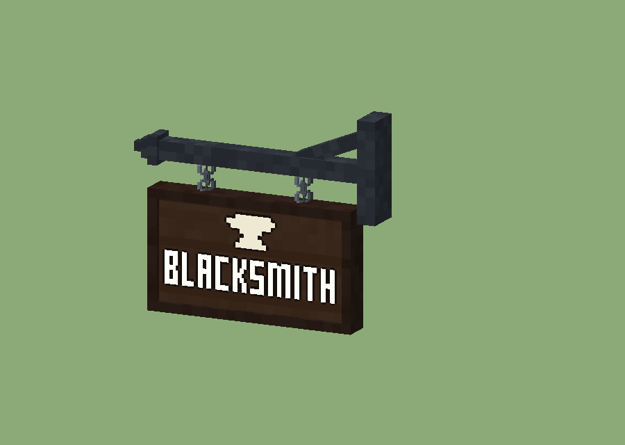

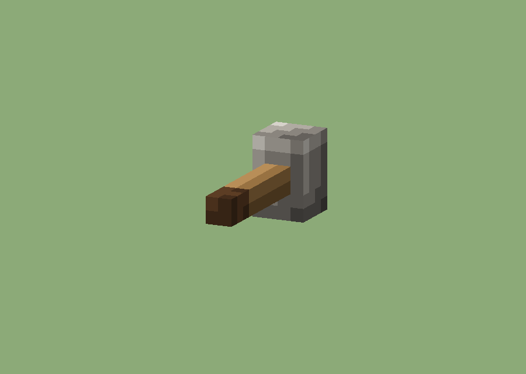

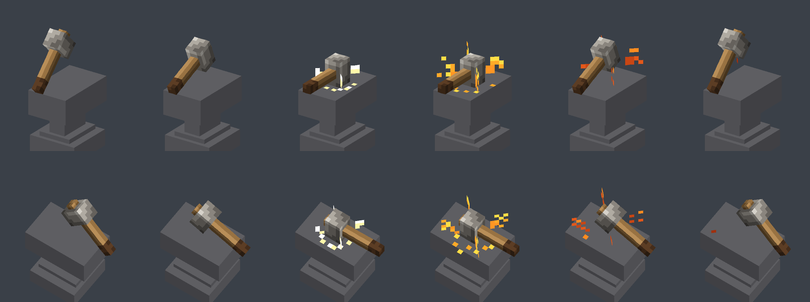

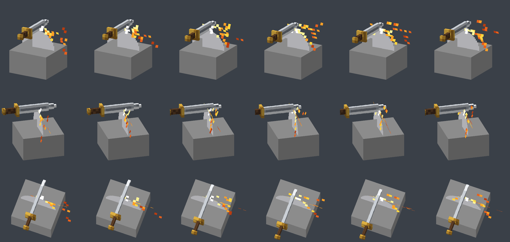

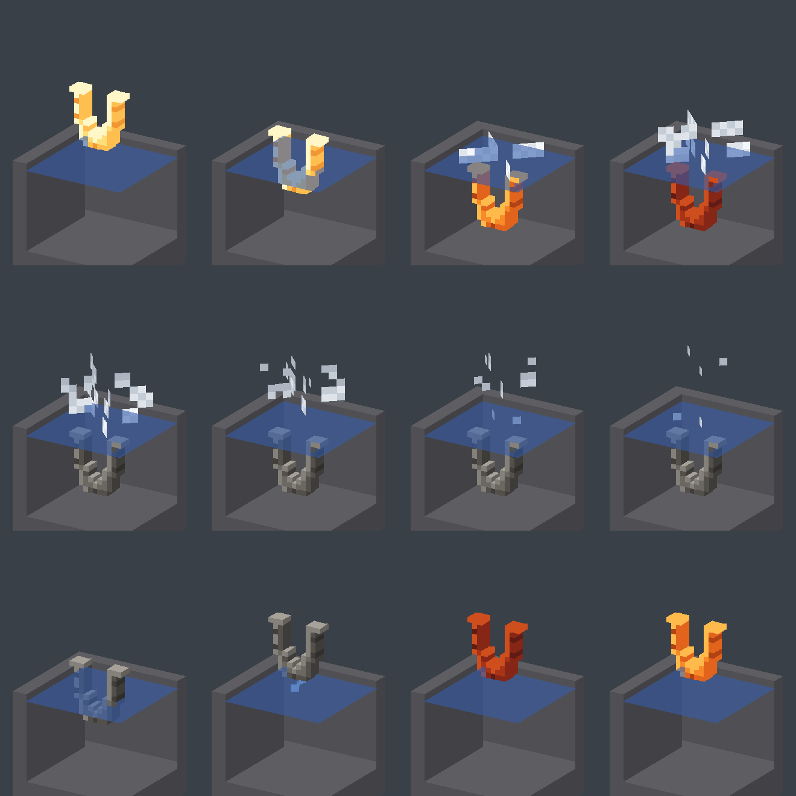

[All five live blacksmith items, models, and textures](docs/artstyle/CATALOGUE.md#blacksmith--all-five-live-items). The vanilla stonecutter override is also linked there. Historical removed furnaces and forge prototypes are not silently included as live features.

### 10.2 Ivy paintings — composition, personality, and intentional pixels

Keep Ivy recognisably a black Labrador: floppy ears, dark face separated by controlled values, and expressive features that read at the final canvas size. Preserve the composition, collar, props, and palette unless explicitly asked to change them. Paintings can use richer pictorial shading than a tiny terrain prop; this is still pixel art, with deliberate final pixels.

The coarse Crown and detailed Crown are **separate intentional variants**. Their coexistence is not permission to resample or homogenise every portrait. Square meme portraits and tall portraits have different compositions; preserve their intended framing.

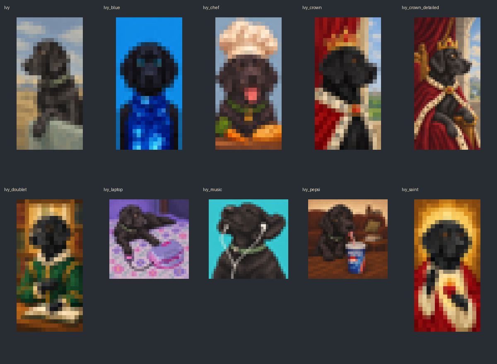

[All ten paintings with individual images, item definitions, models, resolved parent models, and textures](docs/artstyle/CATALOGUE.md#ivy-paintings--all-ten-live-items).

**Editing paintings:** work from the intended composition or retained higher-resolution concept where appropriate, then deliberately reduce to the final pixel canvas. Inspect the final small canvas. Do not repeatedly smear, resize, or locally distort the exported pixels. Do not change Ivy's collar, face, or unrelated props during an edit to another part. Chef Ivy's earlier bowl/spoon/fruit trials were reverted; use the current source, not a historical trial named “approved”.

### 10.3 Kitchen models — the clearest small-prop reference

The bread board demonstrates warm wood, restrained crust marks, a readable pale cut face, and a distinct knife. The pan separates dark metal, a wooden handle, and colourful ingredients. Readable shape and selective surface detail work together; neither plain boxes nor intricate realistic mesh detail alone achieves this.

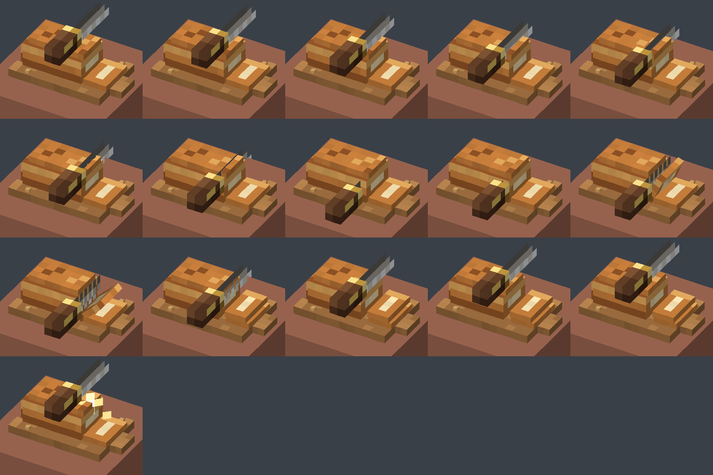

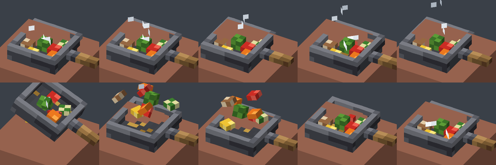

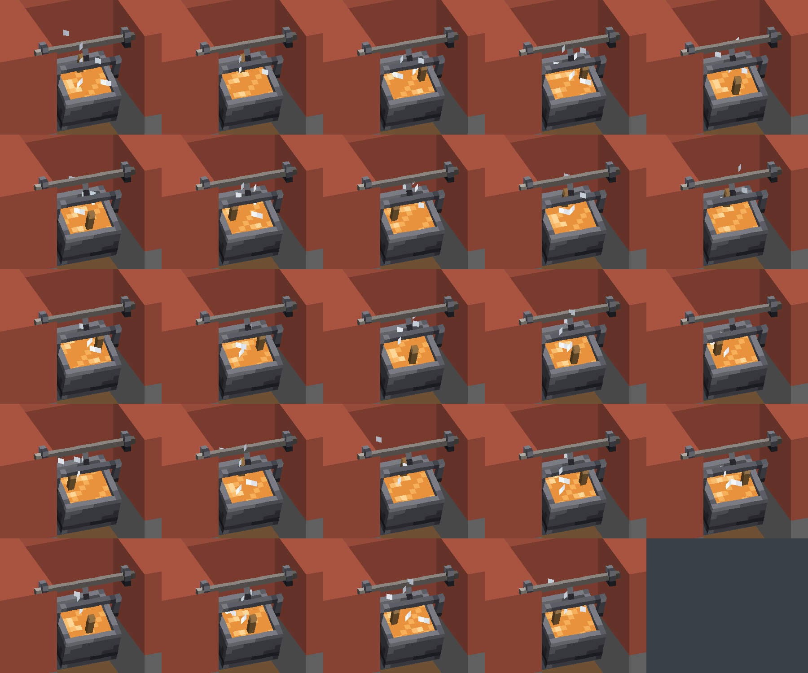

[All three kitchen items, models, textures, and animation metadata](docs/artstyle/CATALOGUE.md#kitchen--all-three-live-items).

**Scope versus approval:** all three are present in current source and are catalogued for completeness. That does not mean every flame treatment, placement, or historical spit concept is separately approved. Match the user's current requested subject and food choices. Do not restore a discarded concept because it appears in a reference sheet.

### 10.4 External reference boards and links

#### Origin Realms — primary external influence

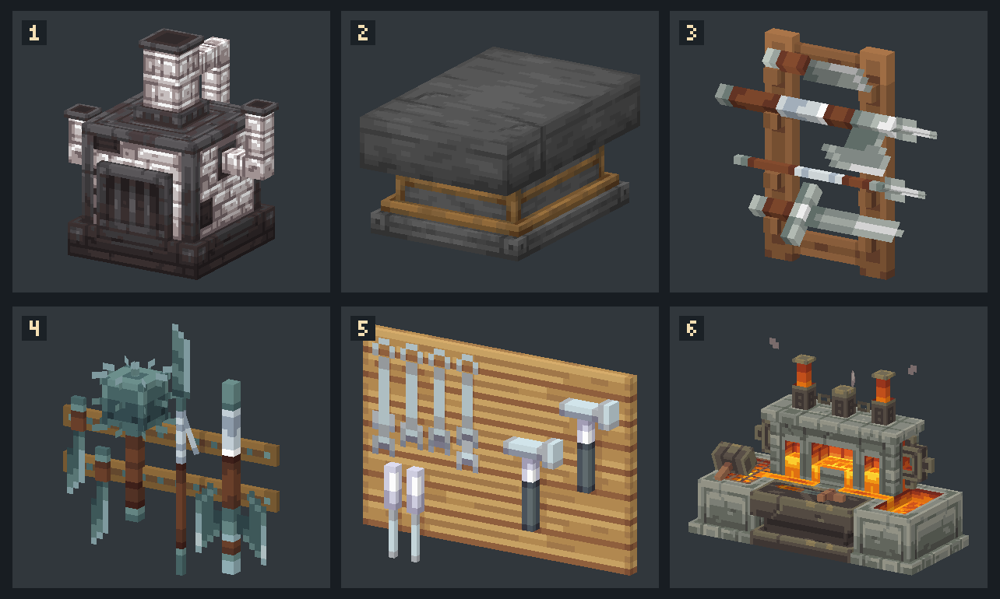

Study recognisable silhouettes, warm timber beside cool iron, selective edge highlights, textured stone, layered construction, and concentrated bright furnace accents. These are visual observations from the board, not a requirement to put metallic trim on every object.

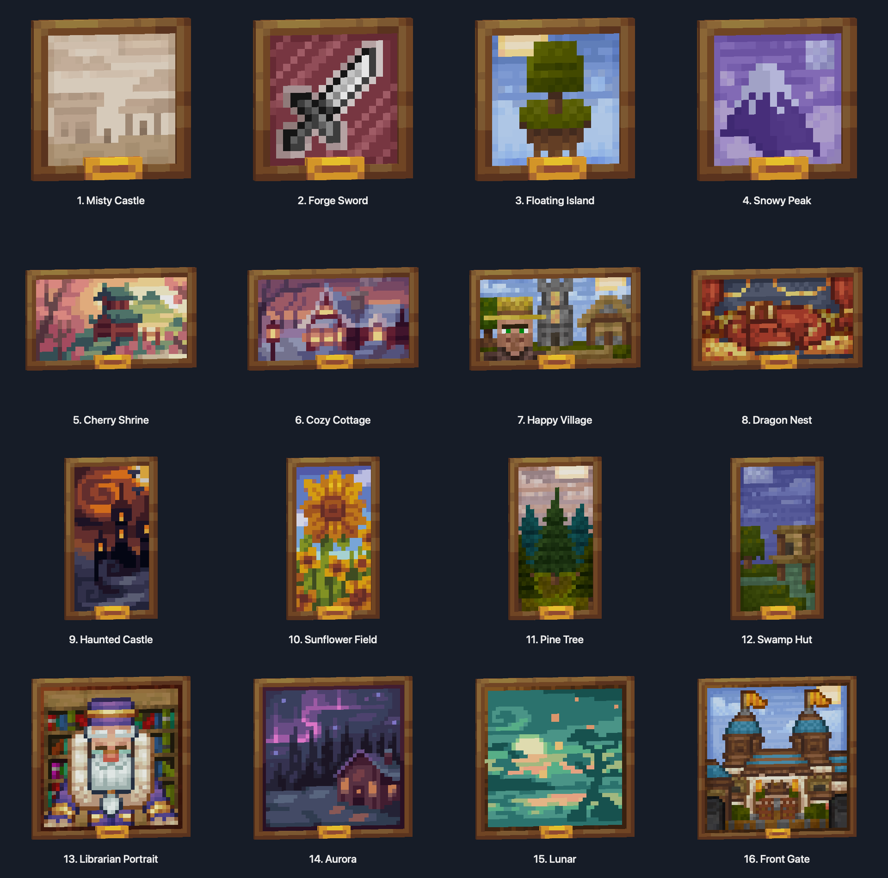

[Complete existing Origin Realms painting board](docs/artstyle/images/origin-realms-paintings.png) · [Official furniture guide](https://originrealms.com/guides/furniture/) · [Official furniture development article](https://originrealms.com/blog/custom-furniture/) · [Official site](https://originrealms.com/)

These local boards already existed in the workspace and are copied here for durable reference. Their original capture date and generation method are not established; do not call them verified in-game screenshots. No complete external resource pack has been newly attached. Use external art as a reference; retain attribution for any existing adapted assets.

#### Rokucraft — additional requested influence

[Official site](https://rokucraft.com/) · [Rokucraft's own project gallery](https://www.planetminecraft.com/member/rokucraft/) · [Officially linked Southern Air Temple image](https://i.imgur.com/Uxch3uK.jpg)

This image is remotely linked, **not stored locally**; it may fail to load offline. The official homepage and creator gallery are references for environmental context. No local Rokucraft resource-pack archive, model inventory, or custom texture set was identified in the searched reference locations. Do not claim a precise model-level style match from a website name, or substitute unrelated “Roguecraft” search results.

### 10.5 Image provenance

All current and future gallery items must distinguish between:

| Provenance | Meaning |
|---|---|
| **Current-source render** | Generated from an identified version of the project's actual model or source data |
| **Texture study** | A direct visual presentation of a texture or painting, not necessarily an in-game capture |
| **Verified in-game screenshot** | Captured from Minecraft with the asset loaded in an identified context |
| **Historical preview** | An older iteration that may no longer match the current implementation |
| **External reference board** | A collection of imagery from another project or external inspiration |
| **Concept/mock-up** | A proposed image or design that has not been verified as an implemented model |

Do not infer these categories from appearance alone.

Where source or provenance is unclear, use **unverified historical image** until it can be established.

The known gallery generation history describes current-source model renders and painting texture studies. These must not be relabelled as fresh in-game screenshots without evidence.

### 10.6 Catalogue maintenance

When a new accepted asset is added, extend the corresponding catalogue with its verified source link and appropriate image.

Do not remove existing gallery entries merely because they depict older asset families.

If an item becomes obsolete, mark it clearly and move it to an explicitly historical reference area if appropriate, rather than silently erasing it.

Check relative links after editing the document.

Keep the actual source and texture paths consistent with the repository.

---

## 11. Approval and historical evidence

Future assistants must distinguish the following statuses:

**Implemented:** The model or texture exists in the current source.

**Technically verified:** Relevant build, loading, or technical checks have succeeded.

**Visually verified:** A genuine render or in-game view has been examined.

**Accepted:** The user has expressly approved the design or sufficiently established it as the preferred version.

**Requested:** A change was requested but may not yet have been completed.

**Experimental:** A concept, alternative, or test version exists without demonstrated approval.

**Rejected or reverted:** The direction was expressly disliked, removed, or reversed.

These statuses are not interchangeable.

A model can be implemented but visually rejected.

A render can be accepted but not installed.

A feature can build successfully while still having broken appearance or positioning in Minecraft.

When approval is uncertain, do not invent it.

---

## 12. Outstanding provenance and history gaps

The following require verification against the live repository or complete prior feature history:

1. The exact contents and paths of the canonical illustrated gallery at the time of application.
2. Whether each historical model version is still present or active in the current resource pack.
3. The precise final accepted furnace material and animation configuration.
4. The final accepted chef painting treatment following multiple ingredient and accessory revisions.
5. The exact accepted cake geometry, motif, rotation, and stage behaviour.
6. The final placement and dimensions of the Elphaba hat and broom.
7. The specific current fountain model and its animation state.
8. The latest accepted configuration of individual environmental decorations.
9. The identity, version, and verification status of any historical preview without source metadata.
10. Whether newer assets have been added to the illustrated catalogue since its last recorded update.

Resolve these questions from source files, feature documentation, screenshots, and explicit user decisions.

Do not fill the gaps with invented approvals or assumed asset paths.

---

## 13. Final art-direction checklist

Before considering a visible asset finished, ask:

- Is the silhouette recognisable?
- Does its geometry have a purpose?
- Does it look like it belongs in Minecraft?
- Does it match the craftsmanship of the blacksmith, Ivy, or kitchen references, as appropriate?
- Are its textures genuinely painted and material-aware rather than flat or noisy?
- Is its pixel scale consistent?
- Are its proportions appealing and suited to the intended location?
- Is the colour palette controlled?
- Does it retain the relevant character and personality?
- Is any animation readable and well synchronised?
- Does it work in its intended display context?
- Have unrelated visual features and existing item compatibility been preserved?
- Has the current source been distinguished from historical experiments?
- Is there actual evidence for any claim of visual approval or in-game verification?

If the model has become simpler but also less recognisable, less carefully textured, or less characterful, the simplification has failed.

If it has become more complex but no clearer or more appealing, that complexity is probably unnecessary.

**The defining Realms Beyond standard is readable Minecraft geometry combined with deliberate painted detail, strong character, and coherent world-building.**

Build on the best accepted work rather than repeatedly reinventing it.
